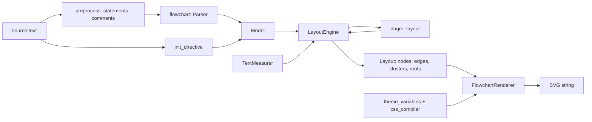

# mermaid.cpp Architecture

mermaid.cpp turns Mermaid text into SVG with **no JavaScript runtime**. It is a from-scratch C++17 implementation.
Behaviour is checked against the SVG that **real Mermaid 12.2.0 produces with `layout: dagre`** (neo look); Mermaid's
source and `dagre-d3-es` 7.0.14 are read as references while developing and are not part of this repo (ADR-0002).
[merman](https://github.com/Latias94/merman), a Rust port, only contributed semantic goldens (`tests/data/merman`).
**No Rust, no JavaScript, no third-party runtime libraries**: only the C++17 standard library and CMake (ADR-0001,
ADR-0006). Decisions and their reasons are in [`docs/adr/`](docs/adr/README.md); the roadmap is `checklist.md`.

Project layout deliberately mirrors [liburlparser](https://github.com/mohammadraziei/liburlparser): public headers
under `include/mermaid/`, flat `src/`, `cmake/` helpers, `tests/cpp` with vendored `utest.h`, `examples/`, CI in
`.github/workflows`.

```
include/mermaid/*.h     public API (namespace `mermaid`, macros `MERMAID_*`); mermaid.h holds the version macros
src/*.cpp, src/*.h      implementation; headers here are private, never installed
cli/main.cpp            mermaid_cli entry point
cmake/                  DynamicVersion, package config, coverage helpers
tests/cpp/test_*.cpp    unit and parity tests (utest.h)
tests/data/             fixture sources, merman goldens, reference SVGs from real Mermaid
tools/                  Node scripts that generate references, font metrics and theme variables
docs/adr/               architecture decision records
examples/               small programs using the public API
```

## 1. Pipeline



Each arrow is a plain data hand-off: stages share value types, never each other's internals, so each stage is tested
alone. `render_svg(source)` runs the whole pipeline; `render_svg(model, layout)` draws a prepared layout.

**Closed subgraphs.** A subgraph with no edge leaving it is laid out as a graph of its own (ADR-0010).
`LayoutEngine` recurses: the inner graph becomes a nested `Layout` in `Layout::roots` (own coordinates, plus the
`box` and `origin` that place it in the parent), the parent sees one node of that size, and the renderer draws a
nested `g.root`. Subgraphs that have edges crossing their border stay compound nodes inside one dagre graph, and
their boxes are dagre's compound nodes.

## 2. Design rules

- **One class, one reason to change.** Parsing, sizing, ranking, ordering, positioning, routing and drawing are
  separate classes.
- **Depend on abstractions at the seams that vary.** `TextMeasurer` (font metrics differ), `NodeSizer` and
  `shape_geometry` (one formula per node shape, outline derived from the size).
- **Value types in, value types out.** Stages are deterministic functions of their inputs; no globals, no hidden
  state, no I/O outside the CLI.
- **Errors are exceptions with positions** (`ParseError{line}`, `UnsupportedDiagram`); layout and render cannot fail on
  a valid model.
- **No third-party runtime dependencies**; anything beyond the standard toolchain needs the owner's approval first.
- **Public vs private headers**: `include/mermaid/` is public and is what tests, examples and consumers use;
  `src/*.h` are private and tests do not get `src/` on their include path (ADR-0005).
- **Naming**: namespace `mermaid`, macros `MERMAID_*`, target `mermaid::mermaid`, std-like `snake_case` for new code
  (ADR-0007).

## 3. Components

| Layer | Class / file | Responsibility |
|---|---|---|
| facade | `render_svg` (`render.h`, `src/render.cpp`) | detect the diagram by its header word, run the pipeline; other diagram types throw `UnsupportedDiagram` |
| cli | `cli::parse_arguments`, `cli::run` | the `mermaid_cli` tool: own argument parser, files/stdin/stdout, exit codes; `cli/main.cpp` forwards `argv` |
| flowchart | `flowchart::Model` | `Node`, `Edge`, `Subgraph`, `ClassDef`, `InitConfig` value types |
| flowchart | `preprocess` | statement splitting, comments, line numbers |
| flowchart | `Parser` | statements, chains, `&` groups, subgraph stack, shapes, edges, `@{ ... }` blocks, class/style/linkStyle |
| flowchart | `style_css` | `fill:#f9f,stroke:#333` -> normalised declarations |
| flowchart | `init_directive` | `%%{init}%%` with a small JSON reader (ADR-0011) |
| text | `TextMeasurer`, `browser_text_measurer` | text width/height from a generated table of Chromium metrics (ADR-0004) |
| layout | `NodeSizer` | node box from label and shape (`flowchart.minNodeWidth`, padding), formulas of `shapes/*.ts` |
| layout | `LayoutEngine` | model -> `dagre::layout` input per graph (closed subgraphs first), result -> geometry, margin fit |
| dagre | `dagre::layout` (public, `dagre.h`) | the dagre pipeline, one class per stage (below), verified against `dagre-d3-es` (ADR-0003) |
| dagre | `Acyclic` | reverse back edges so the graph is acyclic |
| dagre | `NestingGraph` | root node, border nodes and nesting edges for compound nodes |
| dagre | `NetworkSimplexRanker` | rank assignment (feasible tree, cut values, exchanges) |
| dagre | `EdgeNormalizer`, `ParentDummyChains`, `BorderSegments` | dummy chains for long edges (label on its own rank), border columns per compound node |
| dagre | `Orderer` | barycentre sweeps with crossing count, subgraph sorting, conflict resolution |
| dagre | `position` (Brandes-Koepf) | y from ranks, x from four balanced alignments, then direction |
| geometry | `edge_geometry` (public) | clip to node outlines, `fixCorners`, arrow offsets, curves (basis, linear, cardinal), `data-points` |
| render | `SvgWriter` | tiny XML builder with escaping and number formatting |
| render | `theme_variables`, `flowchart_css`, `css_compiler`, `css_color` | the stylesheet of Mermaid 12.2 (neo / redux-color) built, not copied (ADR-0009); only the `default` theme so far |
| render | `Theme` | old simplified styles for `dark`, `forest`, `neutral` (not ported to neo; `checklist.md` S11) |
| render | `shape_geometry`, `node_renderer`, `rough_path` | outline of each shape derived from the node size, neo markup, edge clipping to polygons (ADR-0014); stadium and odd via the rough.js port (ADR-0012) |
| render | `EdgeRenderer` | paths, markers, labels, invisible edges |
| render | `FlowchartRenderer` | root groups (clusters, edge paths, edge labels, nodes), nested roots, document frame |

## 4. Testing strategy (TDD)

1. Write a failing test first.
2. Make it pass with the smallest change.
3. Refactor with the suite green.

Levels: unit tests per class -> parser, layout and render integration tests -> **parity tests** that compare the SVG
with real Mermaid output as an XML tree (tolerance 0.5 on numbers; `tests/data/mermaid_js_dagre/parity.tsv` marks
each fixture `pass` or `todo`; ADR-0008). `ctest` runs everything; the `mermaid_coverage` target (lcov) reports
coverage. References are regenerated with `tools/render_all_references.mjs` (see `agent.md`).

## 5. Out of scope for now

Python bindings, Doxygen docs, benchmarks, an ELK layout and the other diagram types are tracked in `checklist.md`.
