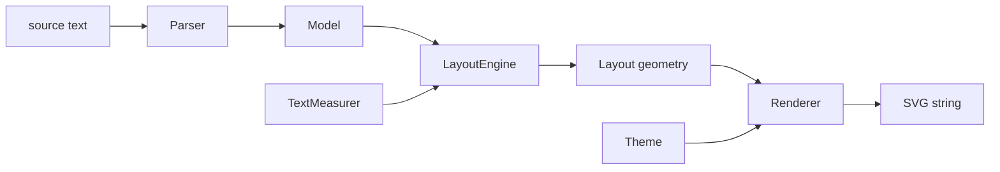

# mermaid.cpp Architecture

mermaid.cpp turns Mermaid text into SVG with **no JavaScript runtime**. It is a
from-scratch C++17 implementation; behaviour is checked against Mermaid **12.2.0** (the latest release; the layout library `dagre-d3-es` 7.0.14 is the same as in 11.16.0)
(read locally as a reference while developing; it is not part of this repo) and the output of
[merman](https://github.com/Latias94/merman), a Rust implementation (only its golden files live here, in
`tests/data/merman`). **No Rust, no system libraries**: only the C++17 standard library and CMake.

Project layout deliberately mirrors
[liburlparser](https://github.com/mohammadraziei/liburlparser): public headers under `include/mermaid/`, flat `src/`, `cmake/` helpers, `tests/cpp` with vendored `utest.h`,
`examples/`, CI in `.github/workflows`.

```
include/mermaid/*.h     public API (namespace `mermaid`, macros `MERMAID_*`);
                        mermaid.h holds the version macros (single source of truth)
src/*.cpp, src/*.h      implementation; headers here are private, never installed
cmake/                  DynamicVersion, package config, coverage helpers
tests/cpp/test_*.cpp    unit tests (utest.h), one file per class
tests/data/             fixtures (merman goldens, ...)
examples/               small programs using the public API
```

## 1. Pipeline



Each arrow is a pure data hand-off: stages share only plain value types, never
each other's internals. That is what makes every stage unit-testable alone.

## 2. Design rules

- **One class, one reason to change.** Parsing, sizing, ranking, ordering,
  positioning, routing and drawing are separate classes.
- **Depend on abstractions at the seams that vary.** `TextMeasurer` (font
  metrics differ per platform), `ShapeRenderer` / `NodeSizer` (one strategy
  per node shape), `Diagram` (one implementation per diagram type).
- **Value types in, value types out.** Stages are deterministic functions of
  their inputs; no globals, no hidden state, no I/O outside the CLI.
- **Errors are exceptions with positions** (`ParseError{line}`); the layout and
  render stages cannot fail on a valid model.
- **No third-party runtime dependencies.** Only the C++ standard library and the standard toolchain (CMake, build-essential). Anything beyond that (submodule or vendor) needs the owner's approval first.
- **Public vs private headers**: everything in `include/mermaid/` is public and
  is what tests, examples and consumers use. `src/*.h` are private and are not
  exported; tests do not get `src/` on their include path.
- **Naming**: namespace `mermaid`, macros `MERMAID_*`, CMake target
  `mermaid::mermaid`.

## 3. Components (target design)

| Layer | Class | Responsibility |
|---|---|---|
| facade | `Mermaid` | `render(text)`: pick diagram by header keyword, run pipeline |
| cli | `cli::parse_arguments`, `cli::run` | the `mermaid_cli` tool: own argument parser, files/stdin/stdout, exit codes; `cli/main.cpp` only forwards `argv` |
| facade | `DiagramRegistry` / `Diagram` | one `Diagram` subclass per Mermaid diagram type |
| flowchart | `flowchart::Model` | `Node`, `Edge`, `Subgraph`, `ClassDef` value types |
| flowchart | `StyleParser` | `fill:#f9f,stroke:#333` -> normalized declarations |
| flowchart | `ShapeScanner` | after an id: `[..]`, `(..)`, `{..}` ... -> shape + label |
| flowchart | `EdgeScanner` | `-->`, `-.->`, `==>`, `--x`, `-- text -->` ... -> edge spec |
| flowchart | `Parser` | statements, chains, `&` groups, subgraph stack, directives |
| text | `TextMeasurer` (interface), `browser_text_measurer` | text width/height |
| layout | `NodeSizer` | node box from label + shape (+ padding) |
| layout | `dagre::layout` (public, `include/mermaid/dagre.h`) | the dagre pipeline, one class per stage (below); verified against `dagre-d3-es` |
| dagre | `Acyclic` | reverse back edges (depth-first) so the graph is acyclic |
| dagre | `NestingGraph` | root node, border nodes and nesting edges for compound nodes |
| dagre | `NetworkSimplexRanker` | rank assignment (feasible tree, cut values, exchanges) |
| dagre | `EdgeNormalizer`, `ParentDummyChains`, `BorderSegments` | dummy chains for long edges (label on its own rank), border columns per compound node |
| dagre | `Orderer` | barycenter sweeps with crossing count, subgraph sorting, conflict resolution |
| dagre | `position` (Brandes-Koepf) | y from ranks, x from four balanced alignments, then direction |
| layout | `LayoutEngine` | flowchart model -> `dagre::layout` input (sizes from `NodeSizer`), result -> geometry (S6f-6b done: every layout number comes from dagre; edge label rank = label + `edge_label_pad` per side; collinear edge points are dropped) |
| layout | cluster boxes | subgraph rectangles still come from the member boxes plus padding and title (S6b will take them from dagre's compound nodes) |
| render | `SvgWriter` | tiny XML builder with escaping and number formatting |
| render | `Theme` | colours, font, stroke widths |
| render | `ShapeRenderer` family | one class per node shape |
| render | `EdgeRenderer`, `FlowchartRenderer` | paths, markers, labels, z-order |

## 4. Testing strategy (TDD)

1. Write a failing test first (committed as `test(red): ...`).
2. Make it pass with the smallest change (`feat: ...`).
3. Refactor with the suite green.

Levels: unit tests per class -> parser/layout/render integration tests ->
**golden parity** tests against merman fixtures (semantic model first, then
layout numbers). `ctest` runs everything; `mermaid_coverage` (lcov) reports
coverage.

## 5. Out of scope for now

Python bindings, Doxygen docs, benchmarks and the other diagram types are
tracked in `checklist.md`.
