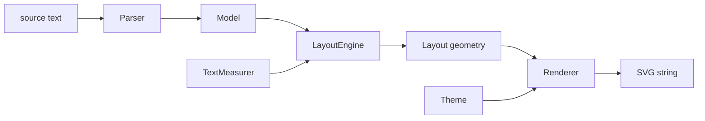

# mermaid.cpp Architecture

mermaid.cpp turns Mermaid text into SVG with **no JavaScript runtime**. It is a
from-scratch C++17 port; behaviour is checked against Mermaid **11.16.0**
(`vendor/mermaid/11.16.0/mermaid.js`, read-only reference) and the Rust port
[merman](https://github.com/Latias94/merman) (`tests/data/merman`, golden files).

Project layout deliberately mirrors
[liburlparser](https://github.com/mohammadraziei/liburlparser): one public
header, flat `src/`, `cmake/` helpers, `tests/cpp` with vendored `utest.h`,
`examples/`, CI in `.github/workflows`.

```
include/mermaidcpp.h    public API + version macros (single source of truth)
src/*.cpp, src/*.h      implementation; headers here are private
cmake/                  DynamicVersion, package config, coverage helpers
tests/cpp/test_*.cpp    unit tests (utest.h), one file per class
tests/data/             fixtures (merman goldens, ...)
examples/               small programs using the public API
vendor/                 third-party reference material (see vendor/README.md)
```

## 1. Pipeline



Each arrow is a pure data hand-off: stages share only plain value types, never
each other's internals. That is what makes every stage unit-testable alone.

## 2. Design rules

- **One class, one reason to change.** Parsing, sizing, ranking, ordering,
  positioning, routing and drawing are separate classes.
- **Depend on abstractions at the seams that vary.** `TextMeasurer` (font
  metrics differ per platform), `ShapeRenderer` / `NodeSizer` (one strategy
  per node shape), `Diagram` (one implementation per diagram type).
- **Value types in, value types out.** Stages are deterministic functions of
  their inputs; no globals, no hidden state, no I/O outside the CLI.
- **Errors are exceptions with positions** (`ParseError{line}`); the layout and
  render stages cannot fail on a valid model.
- **No third-party runtime dependencies.** Only the C++ standard library.
- **Public surface is tiny**: `mermaidcpp.h` only. Everything else is private
  to `src/`.

## 3. Components (target design)

| Layer | Class | Responsibility |
|---|---|---|
| facade | `Mermaid` | `render(text)`: pick diagram by header keyword, run pipeline |
| facade | `DiagramRegistry` / `Diagram` | one `Diagram` subclass per Mermaid diagram type |
| flowchart | `flowchart::Model` | `Node`, `Edge`, `Subgraph`, `ClassDef` value types |
| flowchart | `StyleParser` | `fill:#f9f,stroke:#333` -> normalized declarations |
| flowchart | `ShapeScanner` | after an id: `[..]`, `(..)`, `{..}` ... -> shape + label |
| flowchart | `EdgeScanner` | `-->`, `-.->`, `==>`, `--x`, `-- text -->` ... -> edge spec |
| flowchart | `Parser` | statements, chains, `&` groups, subgraph stack, directives |
| text | `TextMeasurer` (interface), `ApproxTextMeasurer` | text width/height |
| layout | `NodeSizer` | node box from label + shape (+ padding) |
| layout | `CycleBreaker` | reverse back edges so the graph is acyclic |
| layout | `Ranker` | longest-path layering |
| layout | `DummyInserter` | split long edges into per-rank chains; label sits on a dummy |
| layout | `CrossingMinimizer` | barycenter sweeps |
| layout | `CoordinateAssigner` | cross-axis placement (isotonic regression) |
| layout | `EdgeRouter` | clip chains to node borders, self loops |
| layout | `ClusterBoxer` | subgraph rectangles |
| layout | `LayoutEngine` | runs the steps in order, applies direction |
| render | `SvgWriter` | tiny XML builder with escaping and number formatting |
| render | `Theme` | colours, font, stroke widths |
| render | `ShapeRenderer` family | one class per node shape |
| render | `EdgeRenderer`, `FlowchartRenderer` | paths, markers, labels, z-order |

## 4. Testing strategy (TDD)

1. Write a failing test first (committed as `test(red): ...`).
2. Make it pass with the smallest change (`feat: ...`).
3. Refactor with the suite green.

Levels: unit tests per class -> parser/layout/render integration tests ->
**golden parity** tests against merman fixtures (semantic model first, then
layout numbers). `ctest` runs everything; `mermaidcpp_coverage` (lcov) reports
coverage.

## 5. Out of scope for now

Python bindings, Doxygen docs, benchmarks and the other diagram types are
tracked in `checklist.md`.
